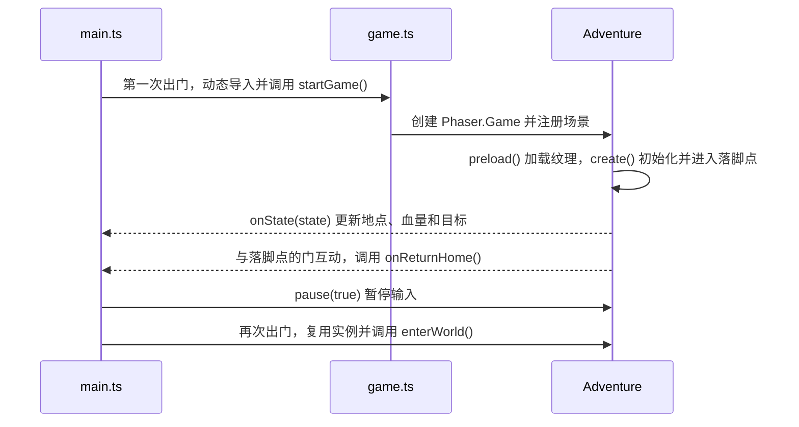

# 从书架到遗迹，再回书房

## 点击书架时，哪段代码打开 Notes？

1. [网页入口](../index.html) 定义书房、导航、阅读面板、游戏画布容器、战斗弹窗和触屏按钮。[页面入口](../src/main.ts) 启动时调用 `mountStudy()` 和 `mountReadingPanel()`。
2. [书房模块](../src/study.ts) 把底图和五个热点放进同一个容器。每个热点有相对原图的百分比坐标和大小，悬停或用 **Tab** 聚焦时会显示同名 PNG 轮廓。桌面尽量铺满画面并保住所有热点，手机显示整幅画。[书房美术](../public/art/study/)
3. 书架和顶部的 **Notes** 都是指向 `#notes` 的链接。[阅读面板模块](../src/readingPanel.ts) 用 Vite 的 `?raw` 导入四份 HTML，并按栏目 ID 选择内容。无论点击哪个入口，还是直接访问带 `#notes` 的网址，打开的都是同一份[笔记](../content/home/notes.html)。原站 PDF 在新标签页打开。
4. 桌面阅读面板贴在画面右侧，手机上占据大部分屏幕。桌面和手机布局、轮廓和正文样式都在 [style.css](../src/style.css)。

## 打开房门时，游戏从哪里开始？

点击房门或 **Enter the world** 时，[页面入口](../src/main.ts) 通过 `import('./game')` 加载[游戏入口](../src/game.ts)，首次调用 `startGame()` 将画布挂到 `#game`。加载期间或加载失败时，**Back to the study** 按钮可以带访客回书房。

**画面怎样生成。** `preload()` 调用 [art.ts](../src/art.ts)，按类别把[户外 PNG](../public/art/world/) 登记成以文件名为键的纹理。`create()` 设置最近邻采样、注册按键，再进入 **The Waystation**。地图由 [maps.ts](../src/game/maps.ts) 里的 `layout()` 提供。每张地图有 32 列、17 行，每格 24 像素，原始画布为 768 × 408。`pixel()` 把从零开始的格坐标换成格子中心的像素坐标。进入 **Hollow Arch** 时，`enter(area, spawn)` 调用 `drawArea()`，重建地形、装饰、碰撞格和交互点，再把人物放到指定格。

**小人怎样走动。** `update()` 每帧读取键盘和触控方向。[movement.ts](../src/game/movement.ts) 的 `movePosition()` 根据经过的时间计算位移，将斜向速度归一化，再分别尝试横向和纵向移动。`canStand()` 检查人物碰撞框的四角，每个角都要落在可通行且未被 `block()` 占用的格子上。分两轴移动让小人可以沿墙滑动。

**网页和游戏怎样通信。** 游戏向页面返回 `GameControls`，接受 `enterWorld()`、`setDirection(direction, pressed)`、`interact()` 和 `pause(paused)`。其中 `Direction` 是四个移动方向。触屏按下和松开都会更新方向，打开面板、战斗弹窗或回书房时会暂停游戏输入并清掉按键状态。页面向游戏提供 `GameCallbacks`。类型和实现可一起在 [game.ts](../src/game.ts) 中查阅。

| 场景调用的回调 | 页面怎样响应 |
| --- | --- |
| `onState(state)` | 更新地点、目标、当前交互提示、血量和灯。`emit()` 只发送变化后的显示状态。 |
| `onEncounter(encounter)` | `Encounter` 提供敌人名称、预计伤害、当前血量及确认或取消的函数。页面将数值填入[战斗预览模板](../content/game/interface.json)并显示按钮。 |
| `onReturnHome()` | 收起画布，显示书房，把焦点还给房门。 |

## 折返和完成探索有什么区别？

走近哨兵可以先预览战斗，确认后扣 3 点血。玩家也可以操作绞盘，从北侧通道绕行。休息点把血量恢复到 8 点。沿路拿灯后，回桥头互动会让隐桥显现。`redrawRuin()` 保留人物位置和朝向，按新的机关状态重画遗迹。

踏上隐桥时，`trackBridgeCrossing()` 记住出发岸。中途掉头退回原岸，任务目标仍是过桥。抵达对岸才会把 `crossedBridge` 设为真，之后落脚点的旅人也会说出另一句对白。游戏根据这些状态，从 [world.json](../content/game/world.json) 读取相应的地名、对白、目标和物件提示。

回书房时，网页暂停同一个 `Adventure` 实例。再出门时，`enterWorld()` 刷新画布尺寸并重画落脚点，出生格为 `WAYSTATION_ENTRY`（`[5, 13]`）。当前血量、灯、哨兵、机关和过桥进度仍属于这一局。刷新或关闭网页会结束这一局。
